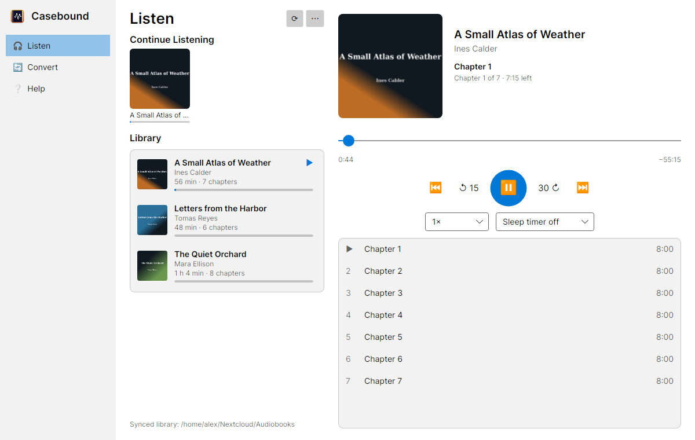

# Casebound Audio for Linux

Casebound turns a folder of MP3/M4A/etc. files into a single chaptered M4B audiobook, and plays your
audiobook library with positions that sync across devices through any folder-sync service
(Nextcloud, Dropbox, Syncthing…). This is the Linux version. iOS, macOS and Windows versions exist too.



## Install

- **Flathub:** `flatpak install flathub io.github.lhead001.Casebound` (once published)
- **AppImage:** download `Casebound-x86_64.AppImage` from Releases, `chmod +x`, run.

## Build from source

Requirements: .NET 10 SDK, ffmpeg/ffprobe on PATH, libvlc 3.x (`libvlc5` / `vlc-plugin-base`).

```sh
dotnet test tests/Casebound.Tests
dotnet run --project src/Casebound.Linux
dotnet run --project src/Casebound.Linux -- --selftest   # checks ffmpeg, libvlc, data dirs
```

### Flatpak

```sh
flatpak install --user flathub org.freedesktop.Sdk//26.08 org.freedesktop.Sdk.Extension.dotnet10//26.08
flatpak-builder --user --install --force-clean build flatpak/io.github.lhead001.Casebound.yaml
flatpak run io.github.lhead001.Casebound
```

After changing NuGet dependencies, regenerate `flatpak/nuget-sources.json` with
[flatpak-dotnet-generator](https://github.com/flatpak/flatpak-builder-tools/tree/master/dotnet):

```sh
python3 flatpak-dotnet-generator.py -f 26.08 -d 10 flatpak/nuget-sources.json \
    src/Casebound.Linux/Casebound.Linux.csproj -r linux-x64 linux-arm64
```

## Layout

| Path | What |
|---|---|
| `src/CaseboundKit` | Engine: ffmpeg decode, AAC encode, MP4/M4B muxer, library + position sync |
| `src/Casebound.Linux` | Avalonia UI, libVLC playback, MPRIS media controls |
| `src/abtool` | Command-line converter |
| `tests`, `harness`, `spec` | Unit tests, conversion harness, cross-platform position-key vectors |
| `packaging` | .desktop, AppStream metainfo, icons |
| `flatpak` | Flatpak manifest, launcher, NuGet sources |

## Privacy

No accounts, analytics, or network access. Your library and listening positions stay in folders you choose.

## License

GPL-3.0-or-later. See [LICENSE](LICENSE). Bundled components: libVLC (LGPL-2.1+), FFmpeg (LGPL-2.1+ build),
Avalonia, Tmds.DBus, SkiaSharp, HarfBuzzSharp (MIT), LibVLCSharp and TagLibSharp (LGPL-2.1).
